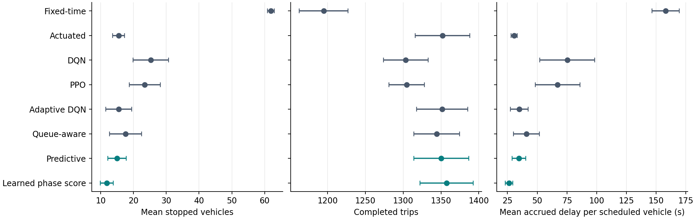

# SafeRL-TrafficLight

How should a four-way intersection allocate the next green when the busiest approach shifts? This Eclipse SUMO benchmark compares eight traffic-signal controllers on identical vehicle demand—including the network, runnable scenarios, three deep RL checkpoints, a 12-feature learned phase-scoring policy, and per-seed evaluation logs.

**中文简介**　在同一个仿真路口、三种车流和八个独立评测种子（1101–1108）上，优化后的 12 特征学习型相位评分策略相对上一版队列控制器（Queue-aware），在 **24/24 全部配对实验** 中同时降低了队列与延误，平均停车数下降 **12.5%–32.5%**。在训练阶段完全未见过的随机到达车流（Stochastic）中，每辆计划出行车辆的平均累计延误从 **40.84 秒降至 26.37 秒（-35.4%）**，较此前表现最好的 SUMO 原生感应控制（**30.59 秒**）再降 **13.8%**，同时取得全场最短平均队列（**11.87 辆**）与最高完成行程数（**1357.4 辆**）。

## Run the intersection

Install Eclipse SUMO, set `SUMO_HOME` to its installation directory and add its `bin` directory to `PATH`. The supplied configuration opens a fixed-time simulation. Press ▶ in SUMO-GUI to start it. [SUMO installation instructions](https://sumo.dlr.de/docs/Installing/index.html)

```sh
git clone https://github.com/Doooooooove/SafeRL-TrafficLight.git
cd SafeRL-TrafficLight
sumo-gui -c scenario/single-intersection.sumocfg
```

For live playback of the learned policy under random arrivals, install the Python dependencies and run the playback script. Choose `--controller predictive` to see the 20-second forecast controller on the same demand.

```sh
python -m pip install -r requirements.txt
python run_gui_dqn.py --controller learned-phase --route-file scenario/stochastic.rou.xml --seconds 2000 --seed 1101
```

## How the signals decide

The intersection has eight incoming lanes, twelve turning movements and four green phases. Agent-controlled signals make a decision every five seconds. The signal enforces two seconds of yellow on a phase change and a minimum of five seconds of green.

- **Predictive control** estimates when vehicles will reach the back of each queue, smooths recent lane entries and forecasts how many vehicles can clear on green. It compares legal phase sequences over four five-second intervals, gives more weight to lanes with longer waits, and applies the first decision before forecasting again.
- **Learned phase scoring** evaluates all four phases with a shared 12-term linear score. Alongside the eight core demand and history terms (stopped vehicles, moving vehicles within and beyond 75 m, waiting time, opposing-approach demand, retaining green, time since service, and smoothed recent entries), it adds four arrival-and-discharge terms: time-to-queue-tail approaching demand, capped dischargeable volume when continuing green, long-queue pressure (> 4 stopped vehicles), and parallel opposite-approach discharge on green continuation. Cross-entropy policy search fits 11 weights from closed-loop simulations with the stopped-vehicle weight anchored at 1.0, optimizing queue, accrued delay, and unfinished trips without touching the held-out stochastic benchmark. The fitted model is a 12-line JSON file (backwards-compatible with the legacy 8-weight format). [Inspect the weights](models/phase_policy.json)
- **Queue-aware control**, the strongest queue baseline in the previous release, uses lane vehicle counts and waiting times, with a small preference for continuing a useful green.
- **DQN, PPO and Adaptive DQN** use a 25-value observation containing queues, following gaps, phase indicators, a phase timer and closing-risk features. Adaptive DQN uses a masked Double DQN target and queue-controller demonstrations during training.
- **Fixed-time and actuated control** run their native SUMO programs. The benchmark checks the active program after each reset.

## Benchmark

Each row uses eight matched simulation seeds (1101–1108), starting empty and running for 2,000 seconds. The original demand favors north–south traffic throughout that window. The alternating scenario changes the dominant axis every 500 seconds. The stochastic scenario uses the same alternating rates with per-second Bernoulli arrivals. It was reserved for evaluation. All eight controllers received the same number of scheduled vehicles for each scenario and seed.

| Controller | Original queue (veh) ↓ | Alternating queue (veh) ↓ | Stochastic queue (veh) ↓ | Stochastic delay (s/veh) ↓ | Stochastic arrivals ↑ |
| --- | ---: | ---: | ---: | ---: | ---: |
| Fixed-time | 40.41 | 60.27 | 61.89 | 157.91 | 1194.9 |
| Actuated | 9.41 | 9.89 | 15.46 | 30.59 | 1351.9 |
| DQN | 12.05 | 15.88 | 25.26 | 75.26 | 1303.5 |
| PPO | 24.14 | 21.21 | 23.44 | 67.08 | 1304.6 |
| Adaptive DQN | 9.82 | 10.22 | 15.47 | 34.96 | 1351.4 |
| Queue-aware | 8.49 | 9.29 | 17.57 | 40.84 | 1344.3 |
| Predictive | **7.40** | 7.99 | 14.97 | 34.53 | 1350.4 |
| Learned phase score | 7.42 | **7.71** | **11.87** | **26.37** | **1357.4** |

The learned phase scorer beat the previous queue-aware rule on **both mean queue and accrued delay in all 24 paired runs**, cutting mean stopped vehicles by **12.5%–32.5%** and accrued delay per scheduled vehicle by **11.8%** on original demand (`20.86 → 18.40 s`), **15.9%** on alternating demand (`22.41 → 18.85 s`), and **35.4%** on stochastic demand (`40.84 → 26.37 s`). It achieved the **lowest accrued delay across all three scenarios**. On the held-out stochastic profile, it outperformed native SUMO actuated control in **8/8 seeds** on queue (`11.87` vs `15.46`, **-23.2%**) and accrued delay (`26.37` vs `30.59 s`, **-13.8%**), and led on completed trips (`1357.4` vs `1351.9`, **6–1–1** W–T–L) with zero hard-brake samples. Predictive control remained slightly shorter on original-profile mean queue (`7.40` vs `7.42`). These measurements describe one simulated intersection.



**Queue** is the number of vehicles moving below 0.1 m/s across the network, sampled every five seconds and averaged over the episode. **Arrivals** count completed trips at every simulation second. **Accrued delay** sums SUMO departure delay and in-network time loss through the cutoff and divides by the number of scheduled vehicles. It includes vehicles waiting to enter, vehicles still driving and completed trips. The CSVs also report sampled current waiting spells, speed, TTC pair samples and hard braking. A following pair can contribute to multiple TTC samples. The older figures in `plots/` use earlier metric definitions.

Each results folder contains the per-seed runs, summary with sample standard deviations, and chart. [Original](results/original) · [Alternating](results/alternating) · [Stochastic](results/stochastic)

## Reproduce the results

The published runs used Python 3.13.2, SUMO and libsumo 1.27.1, SUMO-RL 1.4.5, Stable-Baselines3 2.9.0 and CPU PyTorch 2.14.0. Standard TraCI works for both benchmarking and GUI playback. To speed up headless runs, install the matching libsumo version and set `LIBSUMO_AS_TRACI=1` in the benchmark shell. Use a standard TraCI shell for GUI playback.

```sh
python run_ablation_and_comparison.py --output-dir results/original
python run_ablation_and_comparison.py --route-file scenario/alternating.rou.xml --output-dir results/alternating
python run_ablation_and_comparison.py --route-file scenario/stochastic.rou.xml --output-dir results/stochastic
python -m unittest discover -s tests -v
```

The defaults reproduce all eight evaluation seeds. For a short comparison, add `--seeds 1101 --controllers actuated queue predictive learned-phase`. The runner checks each episode’s completed-trip count against SUMO’s trip log.

### Train a policy

Phase-score training evaluates each candidate on both deterministic demand profiles plus two generated Poisson demand profiles (`balanced` and `varying`) built solely from the original network’s routes. Eight generations of 72 candidates run on seeds `1800–1807` (1,200 s episodes), shortlisted policies are validated on full 2,000 s episodes over seeds `2901–2903`, and local perturbations are refined on development seeds `7, 17, 29, 37`. The ranking objective combines mean queue, accrued delay per scheduled vehicle, and unfinished trip fraction. Both `scenario/stochastic.rou.xml` and evaluation seeds `1101–1108` remain strictly held out.

```sh
python train_phase_policy.py --workers 4 --output models/retrained_phase_policy.json
python train_adaptive_dqn.py --seed 42 --output models/retrained_adaptive_dqn.zip
python train_unified_rl.py --algorithm dqn --steps 6000 --output-dir models/retrained
```

## Scenario credits

The intersection network and original traffic routes come from Lucas Alegre’s SUMO-RL 1.4.5 distribution. The two additional scenarios adapt its demand periods and arrival process. [Upstream SUMO-RL](https://github.com/LucasAlegre/sumo-rl) · [Scenario license](scenario/LICENSE.sumo-rl)
