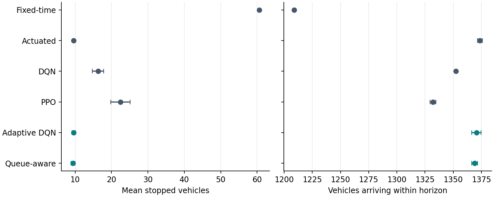

# SafeRL-TrafficLight

A reproducible SUMO experiment for a four-way signalized intersection. Compare three learned policies (DQN, PPO and a demonstration-trained Double DQN), a queue-aware controller, and SUMO’s native fixed-time and actuated programs. The repository includes the network, demand files, trained checkpoints and per-seed results.

**中文简介**　这个项目比较六种路口信号控制方法。在三个独立评测种子上，新版 DQN 相对原版 DQN 的平均停车数降低了 26.9%（持续南北高峰）和 41.1%（主流向每 500 秒切换）。两个场景的平均到达车辆数也有所增加。

## Run the intersection

Install Eclipse SUMO, set `SUMO_HOME` to its installation directory and add its `bin` directory to `PATH`. The native scenario opens directly in SUMO-GUI. Press ▶ to start the simulation. [SUMO installation instructions](https://sumo.dlr.de/docs/Installing/index.html)

```sh
git clone https://github.com/Doooooooove/SafeRL-TrafficLight.git
cd SafeRL-TrafficLight
sumo-gui -c scenario/single-intersection.sumocfg
```

To watch the learned controller handle alternating demand, install the Python dependencies and start policy playback. The model is included in the clone.

```sh
python -m pip install -r requirements.txt
python run_gui_dqn.py --controller adaptive-dqn --route-file scenario/alternating.rou.xml --seconds 2000
```

## What the controllers see and do

The intersection has eight incoming lanes, four green phases and twelve turning movements. Learned policies choose a green phase every five seconds. Their 25 inputs comprise eight normalized queues, eight leader-gap features, four phase indicators, one phase timer and four approach-level closing-risk features. A phase change includes two seconds of yellow and a minimum of five seconds of green. SUMO handles individual vehicle motion.

The **queue-aware controller** scores each phase using the number of approaching vehicles and their lane waiting times. It counts each served lane once, even when right-turn and through movements share it. A small bias toward an occupied current phase avoids spending green time on marginal switches.

The **adaptive DQN** learns from that controller and exploratory actions across both demand patterns. It uses 11,200 simulated decisions, a masked Double DQN target and an auxiliary loss that predicts the teacher’s action. The learning reward favors arrivals and penalizes queues and observed hard braking. At playback the network needs only the 25 inputs. The benchmark also evaluates the original DQN and PPO checkpoints.

## Benchmark

Each cell summarizes three runs from an empty network, with seeds **101, 202 and 303**, 2,000 simulated seconds per run and the same demand file for every controller. The original demand favors north–south traffic during this window. The alternating profile preserves the vehicle rates and swaps the dominant axis every 500 seconds. Training episodes used seeds 10042–10069, and model selection used 7, 17, 29 and 37. The benchmark covers one intersection.

| Controller | Original · stopped vehicles ↓ | Original · arrivals ↑ | Alternating · stopped vehicles ↓ | Alternating · arrivals ↑ |
| --- | ---: | ---: | ---: | ---: |
| Fixed-time | 40.56 ± 0.13 | 1145.7 | 60.62 ± 0.18 | 1209.0 |
| Actuated | 9.30 ± 0.05 | 1363.0 | 9.56 ± 0.11 | **1373.7** |
| DQN | 12.36 ± 1.25 | 1359.7 | 16.29 ± 1.57 | 1352.3 |
| PPO | 25.04 ± 1.57 | 1340.7 | 22.45 ± 2.63 | 1332.0 |
| Adaptive DQN | 9.04 ± 1.00 | 1361.7 | 9.60 ± 0.47 | 1370.7 |
| Queue-aware | **8.64 ± 0.24** | **1364.0** | **9.37 ± 0.53** | 1369.0 |

The queue-aware rule achieved the shortest mean queues in both profiles. The actuated program served the most arrivals in alternating traffic and recorded the lowest sampled mean waiting time in both profiles. On alternating traffic, adaptive DQN also reduced the mean count of sampled close-following pairs from 1313 to 674 compared with the original DQN.

Stopped vehicles are counted at each five-second decision boundary and averaged over the episode. The ± values are sample standard deviations across seeds. Arrivals count completed trips at every simulation second, including seconds between decisions. Waiting time measures the current waiting spell of vehicles on the network, averaged first across vehicles and then across samples. Vehicles awaiting entry are outside that queue and waiting measurement. A TTC sample counts an incoming follower–leader pair with positive gap, closing speed above 0.5 m/s and time to collision below 1.5 seconds. A pair can contribute at multiple sampling times. Hard-brake samples use acceleration below −4.5 m/s².



Per-seed records and summaries include waiting time, speed, TTC samples and hard braking. The older figures in `plots/` use the previous throughput and waiting-time definitions. [Original-demand runs](results/original/runs.csv) · [Alternating-demand runs](results/alternating/runs.csv) · [Original summary](results/original/summary.csv) · [Alternating summary](results/alternating/summary.csv)

## Reproduce the results

The published runs used Python 3.13.2, SUMO and libsumo 1.27.1, SUMO-RL 1.4.5, Stable-Baselines3 2.9.0 and CPU PyTorch 2.14.0. The commands also work with the standard TraCI backend. For faster headless runs, install the matching libsumo version and set `LIBSUMO_AS_TRACI=1` in the benchmark shell. Use the standard TraCI backend for GUI playback.

```sh
python run_ablation_and_comparison.py --seeds 101 202 303 --seconds 2000 --output-dir results/original
python run_ablation_and_comparison.py --seeds 101 202 303 --seconds 2000 --route-file scenario/alternating.rou.xml --output-dir results/alternating
python -m unittest discover -s tests -v
```

To reproduce the new policy, train it with the default seed of 42. Use a separate output path to keep the published checkpoint available for comparison.

```sh
python train_adaptive_dqn.py --seed 42 --output models/retrained_adaptive_dqn.zip
```

For online DQN or PPO training with the corrected interval-throughput reward, run `python train_unified_rl.py --algorithm dqn --steps 6000 --output-dir models/retrained` and choose `ppo` for PPO. `--controllers` on the benchmark command selects a subset, for example `--controllers actuated adaptive-dqn queue`.

## Scenario credits

The intersection network and original traffic routes come from Lucas Alegre’s SUMO-RL 1.4.5 distribution. The alternating scenario shortens the four demand periods to 500 seconds each. [Upstream SUMO-RL](https://github.com/LucasAlegre/sumo-rl) · [Bundled scenario license](scenario/LICENSE.sumo-rl)
